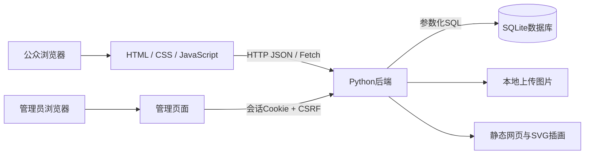
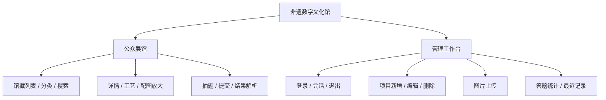
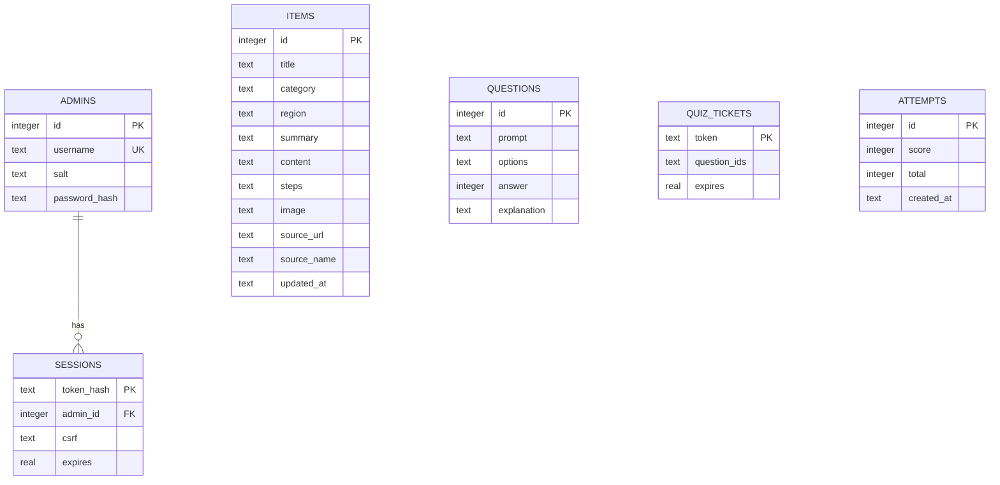

# 技术说明与课程要求对应

## 一、设计目标与范围

课题：基于Web的非遗数字文化展示与管理系统设计与实现。

受众是希望快速了解江南手工艺的普通观众，以及维护馆藏内容的管理员。观众可浏览、检索、阅读、放大配图和答题；管理员可维护馆藏并查看答题统计。

数字媒体技术体现在：SVG矢量插画、图文信息组织、图片上传与展示、图片放大交互、响应式界面、互动测验与即时反馈。系统以图片与文字为主要媒介，不声称实现3D扫描、专业图像修复或视频处理。

## 二、与课程要求的对应

| 课程要求 | 项目对应内容 | 报告中可以展示的材料 |
| --- | --- | --- |
| 数字媒体主题 | 非遗图文展陈与互动学习 | 首页、馆藏详情、原创SVG |
| 网页有前端和后端 | HTML/CSS/JS＋Python HTTP服务 | 浏览器请求与API代码 |
| 调查和需求分析 | 访客阅读/检索/答题，管理员维护内容 | 用例、需求表（应结合本人实际调研补充） |
| 数据流图与数据字典 | 查询、写入、评分等业务数据流 | 本文数据流、下表字段 |
| 概念模型ER图 | 管理员、会话、馆藏、题库、答题记录 | 本文ER图 |
| 功能模块设计 | 展馆、检索、详情、答题、登录、内容管理、统计 | 功能结构图 |
| 逻辑和物理设计 | SQLite表结构、图片文件存储、接口划分 | 数据表和文件目录 |
| 系统实现与所有界面 | 公众首页、详情、大图、答题、结果、后台登录、管理、编辑、删除确认 | 自己运行时截图及每个界面主要代码 |
| 操作说明、运行及维护 | README启动、演示、备份与运行边界 | README及实际运行记录 |
| 遇到的问题及解决办法 | 前后端联调、SQLite连接关闭、异步表单处理等 | 结合实际测试与学习整理 |

这份说明提供技术素材，不代表老师已经验收或必然给分。正式报告仍需按课程模板完成，并体现本人的实际工作。

## 三、系统架构



前端负责呈现和收集输入；后端负责身份校验、输入验证、SQL查询和评分；数据库负责持久保存。浏览器与后端使用同一地址，无需跨域配置。

技术选择：HTML5与原生JavaScript让代码规模较小且容易讲解；Python标准库减少安装问题；SQLite不需要单独启动数据库服务，适合本地课程演示。

## 四、功能结构



## 五、主要业务数据流

### 5.1 访客检索

搜索词和分类 → JavaScript生成查询参数 → GET /api/items → 后端参数化SQL → items表 → JSON项目数组 → 前端渲染卡片。无结果时显示空状态，不伪造内容。

### 5.2 管理员保存馆藏

输入账号密码 → 后端验证PBKDF2摘要 → 创建会话 → 设置HttpOnly Cookie → 后续保存携带Cookie与CSRF请求头 → 检查输入 → 写入items表 → 返回成功 → 刷新管理列表与前台内容。

### 5.3 图片上传

选择文件 → 浏览器转Base64 → POST /api/upload → 后端检查登录、CSRF、大小与图片签名 → 随机文件名保存 → 返回图片相对路径 → 保存项目时将路径写入items表。

### 5.4 答题评分

GET /api/quiz → 后端抽5题并建立限时票据 → 浏览器只接收题目和选项 → 提交票据与答案 → 后端核对票据、验证是否全部作答 → 用数据库正确答案评分 → 保存attempts并消费票据 → 返回分数与解析。

题目接口不提前返回正确答案。票据一小时内有效且只可提交一次，防止双击产生重复记录。

## 六、概念模型



说明：只有sessions.admin_id是实际外键。题目ID列表采用JSON保存于票据中，属于应用层关联；答题记录只留聚合得分，不保存访客身份或逐题答案，因此不虚构用户与答题记录的外键关系。

## 七、数据字典

### 7.1 items：馆藏项目

| 字段 | 类型 | 含义 / 约束 |
| --- | --- | --- |
| id | INTEGER | 自增主键 |
| title | TEXT | 项目名称，1至60字 |
| category | TEXT | 传统美术或传统技艺 |
| region | TEXT | 地域，1至60字 |
| summary | TEXT | 卡片简介，1至240字 |
| content | TEXT | 详细故事，1至12000字 |
| steps | TEXT | JSON字符串数组，1至10项，每项最多240字 |
| image | TEXT | 已存在的/assets/或/uploads/本地图片路径 |
| source_url | TEXT | http或https来源链接，最多600字符 |
| source_name | TEXT | 来源名称，最多120字 |
| updated_at | TEXT | UTC更新时间 |

### 7.2 身份与会话

| 表 / 字段 | 类型 | 含义 |
| --- | --- | --- |
| admins.id | INTEGER | 管理员主键 |
| admins.username | TEXT | 唯一账号 |
| admins.salt | TEXT | 随机密码盐 |
| admins.password_hash | TEXT | PBKDF2-HMAC-SHA256，260000轮摘要 |
| sessions.token_hash | TEXT | 随机会话令牌的SHA256摘要，主键 |
| sessions.admin_id | INTEGER | 关联管理员外键 |
| sessions.csrf | TEXT | 写操作CSRF校验值 |
| sessions.expires | REAL | 过期Unix时间戳，会话有效8小时 |

### 7.3 互动学习

| 表 / 字段 | 类型 | 含义 |
| --- | --- | --- |
| questions.id | INTEGER | 题目主键 |
| questions.prompt | TEXT | 题干 |
| questions.options | TEXT | JSON选项数组 |
| questions.answer | INTEGER | 从0开始的正确选项下标 |
| questions.explanation | TEXT | 解析 |
| quiz_tickets.token | TEXT | 一次性答题票据，主键 |
| quiz_tickets.question_ids | TEXT | 本次抽题ID的JSON数组 |
| quiz_tickets.expires | REAL | 票据过期时间 |
| attempts.id | INTEGER | 答题记录主键 |
| attempts.score | INTEGER | 百分制得分 |
| attempts.total | INTEGER | 本次总题数 |
| attempts.created_at | TEXT | UTC提交时间 |

## 八、HTTP接口

| 方法 | 路径 | 功能 | 权限 |
| --- | --- | --- | --- |
| GET | /api/health | 数据库健康检查 | 公开 |
| GET | /api/items?q=&category= | 检索馆藏 | 公开 |
| GET | /api/items/{id} | 馆藏详情 | 公开 |
| GET | /api/quiz | 抽取题目、签发票据 | 公开 |
| POST | /api/quiz/submit | 验证并评分 | 有效答题票据 |
| POST | /api/login | 管理员登录 | 账号密码 |
| GET | /api/session | 查询登录状态 | 公开，按Cookie识别 |
| POST | /api/logout | 销毁会话 | 管理员＋CSRF |
| POST | /api/items | 新增馆藏 | 管理员＋CSRF |
| PUT | /api/items/{id} | 编辑馆藏 | 管理员＋CSRF |
| DELETE | /api/items/{id} | 删除馆藏 | 管理员＋CSRF |
| POST | /api/upload | 上传图片 | 管理员＋CSRF |
| GET | /api/admin/stats | 内容与答题统计 | 管理员 |

答题提交示例：

```json
{"ticket":"由抽题接口返回的票据","answers":{"1":0,"2":1,"3":2,"4":1,"5":2}}
```

实际题目可能是随机抽取的其他ID，前端按真实抽题结果提交，不能硬编码上面的示例。

错误接口统一返回JSON，例如 `{"error":"请先登录管理员账号"}`。HTTP状态码包括400输入无效、401未登录、403校验失败、404不存在、413过大、415格式不支持、429登录过频。

## 九、设计判定表

| 条件 | 未登录写入 | 登录但CSRF错误 | 有效会话但内容无效 | 会话、CSRF、内容均有效 |
| --- | --- | --- | --- | --- |
| 允许修改数据库 | 否 | 否 | 否 | 是 |
| 返回状态 | 401 | 403 | 400 | 200或201 |
| 用户提示 | 先登录 | 刷新重新验证 | 显示具体错误 | 保存成功 |

## 十、运行与维护

静态文件与业务接口由同一Python进程提供。数据库连接按请求使用并及时关闭；写入在事务中完成。用户输入以参数化SQL传入数据库，动态文字经前端HTML转义。后端限制请求体大小、上传类型、可访问文件范围，并使用CSP与nosniff响应头。

固定演示账号和本地HTTP只用于本机课程展示；尚未作为公网生产系统设计。无需云服务或在线发布即可演示本课的前后端要求。

后续可以扩展真实实物照片、多图对比、音视频讲解和题库维护。但本版本优先保持功能完整、容易理解和稳定运行，不加入没有实现的功能说明。
