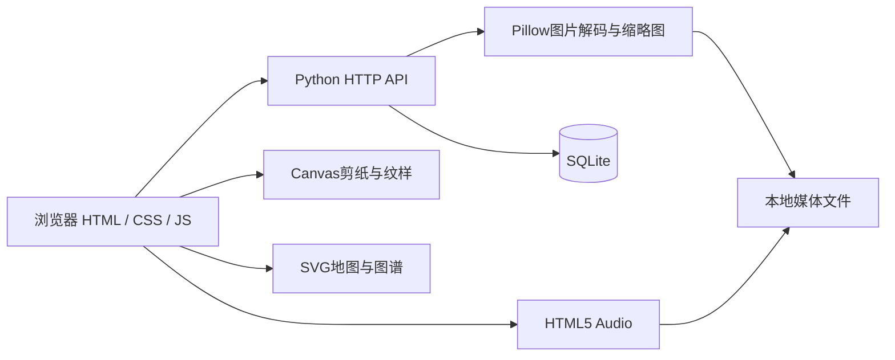
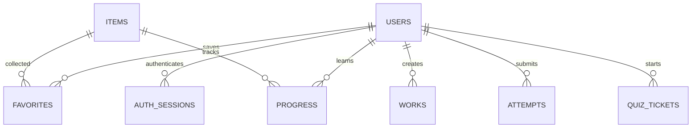

# 拾遗江苏 · 核心技术设计

## 目标与模块

以12项精选非遗为主体，提供图文展陈、地域探索、策展图谱、互动创作、视听学习与用户记录。前端、后端和数据库均实际运行。模块化前端位于static/js，后端业务和数据初始化分别位于museum_server.py、museum_db.py。

## 数字媒体实现

1. **剪纸**：以画布中心为原点，对切线的坐标执行等角旋转；每笔记录点列。重绘时依次应用基本图案与全部操作。撤销/重做使用两个栈，恢复设计参数与操作列表即可复现画面。
2. **纹样**：以间距和大小构造重复网格，在每个单元施加平移、缩放、旋转，绘制花卉、枝叶或几何模板；蓝白反转改变前景与背景色。
3. **作品导出**：Canvas编码PNG，后端验证图像格式和720×720尺寸，再提供同源HTTP附件下载，避免仅依赖data URL下载。
4. **媒体处理**：Pillow真正解码，限制像素与文件大小，应用EXIF方向修正，重编码WebP去除非必要元数据，产生最大2200像素图与560像素缩略图。
5. **地图**：由GeoJSON多边形投影为SVG路径，按数据库城市匹配数量及项目；未收录城市保留空状态。
6. **图谱**：根据数据库的策展专题动态生成树状关联节点与曲线连线，不引入虚构师承关系或语义评分。
7. **音频**：本地WAV、HTTP Range分段响应、原生Audio播放及文字稿。更新讲稿未更换对应音频时清空音频引用，避免错配。

## 数据概念模型

题目和导览是另外的内容实体。guides.item_slug按应用逻辑关联items.slug；quiz_tickets.snapshot保存题目完整快照，而不是实时引用题目答案。历史attempts.details保留当时题干、选择、正确答案和解析。没有为图谱节点单独造表，避免同一馆藏产生重复数据源。

## 核心数据字典

| 表 | 主要字段 | 用途 |
| --- | --- | --- |
| items | id,title,slug,city,category,theme,material,tags,summary,content,steps,image,gallery,source_url,source_name,published | 图文、分类、专题与草稿发布 |
| users | id,username,nickname,salt,password_hash,role | 普通用户与管理员 |
| auth_sessions | token_hash,user_id,csrf,expires | 24小时登录会话 |
| favorites | user_id,item_id | 每个账号独立收藏，复合主键防重复 |
| progress | user_id,item_id,step,completed,updated_at | 学习到的最远步骤和完成状态 |
| works | id,user_id,title,kind,params,image,thumb,created_at | Canvas参数、作品和缩略图 |
| questions | id,prompt,options,answer,explanation,topic | 可维护题库 |
| quiz_tickets | token,question_ids,user_id,snapshot,expires | 一次性抽题凭据和快照 |
| attempts | id,user_id,score,total,details,created_at | 得分、逐题复盘 |
| guides | id,slug,title,item_slug,text,src,voice,kind | 文稿、音频路径与合成语音身份 |
| meta | key,value | 一次性升级与初始化标记 |

旧版admins、sessions等表被保留用于兼容历史备份，新版认证使用users与auth_sessions。时间由SQLite按UTC保存，前端转换为北京时间显示。JSON数组在SQLite中用TEXT存储，由后端统一序列化。

## HTTP接口与业务

| 接口 | 方法 | 功能与权限 |
| --- | --- | --- |
| /api/catalog | GET | 已发布项目、目录、统计与导览 |
| /api/items | GET | 城市、类别、专题、关键词检索 |
| /api/items?all=1 | GET | 管理员查询含草稿的馆藏 |
| /api/items/{id} | GET/PUT/DELETE | 阅读或管理员修改/删除 |
| /api/items | POST | 管理员新增内容 |
| /api/register、/api/login、/api/logout | POST | 注册、认证、退出 |
| /api/session | GET | 当前身份和CSRF值 |
| /api/favorites、/api/me | GET | 当前用户的数据 |
| /api/favorites/{id} | POST/DELETE | 收藏或取消收藏 |
| /api/progress | POST | 记录学习进度，不向后覆盖最远进度 |
| /api/works | POST | 用户保存创作 |
| /api/works/{id} | DELETE | 仅作品所有者可删除 |
| /api/export | POST | 校验Canvas PNG并生成附件链接 |
| /api/quiz、/api/quiz/submit | GET/POST | 抽5/10题、后端评分、消费一次性票据 |
| /api/upload | POST | 管理员图片上传与缩略图 |
| /api/admin/questions[/{id}] | GET/POST/PUT/DELETE | 管理员题库维护 |
| /api/admin/guides[/{id}] | GET/PUT | 管理员文稿与音频引用管理 |
| /api/admin/audio | POST | 管理员上传8MB内、3分钟内的WAV |
| /api/admin/stats | GET | 实际数据库统计 |

写操作采用同源检查，已登录用户的私有写操作还需CSRF请求头。会话Cookie采用HttpOnly和SameSite=Strict，数据库只保存令牌摘要。SQL参数化；前端动态文字经HTML转义。角色与所有权在后端验证，不能通过修改前端按钮绕过。

## 与课程要求对应

| 要求 | 本项目材料 |
| --- | --- |
| 数字媒体应用设计 | 图文、音频、Canvas创作、SVG可视化 |
| 网页前端和后端 | 模块化页面、HTTP API、SQLite |
| 需求与数据流 | 访客发现、用户学习创作、管理员维护 |
| 概念/逻辑/物理设计 | 本文ER关系、字段字典、SQLite和媒体文件目录 |
| 全部界面、主要代码与步骤 | 源码、截图、使用说明；正式报告需按实际过程整理 |
| 运行和维护 | 一键启停、独立环境、备份、测试和升级标记 |
| 分工、参考文献、总结 | 分工建议与来源说明；实际贡献由小组成员记录 |

参考了GitHub的feiyiweb、HayesX/heritage-digital-platform、zDarius21/OpenMuseum在展陈、图谱、分步学习和导览方面的组织方向。主视觉生成记录、插画脚本、文化资料来源均单独保留，不把参考项目的整套实现当作自己的完成记录。
